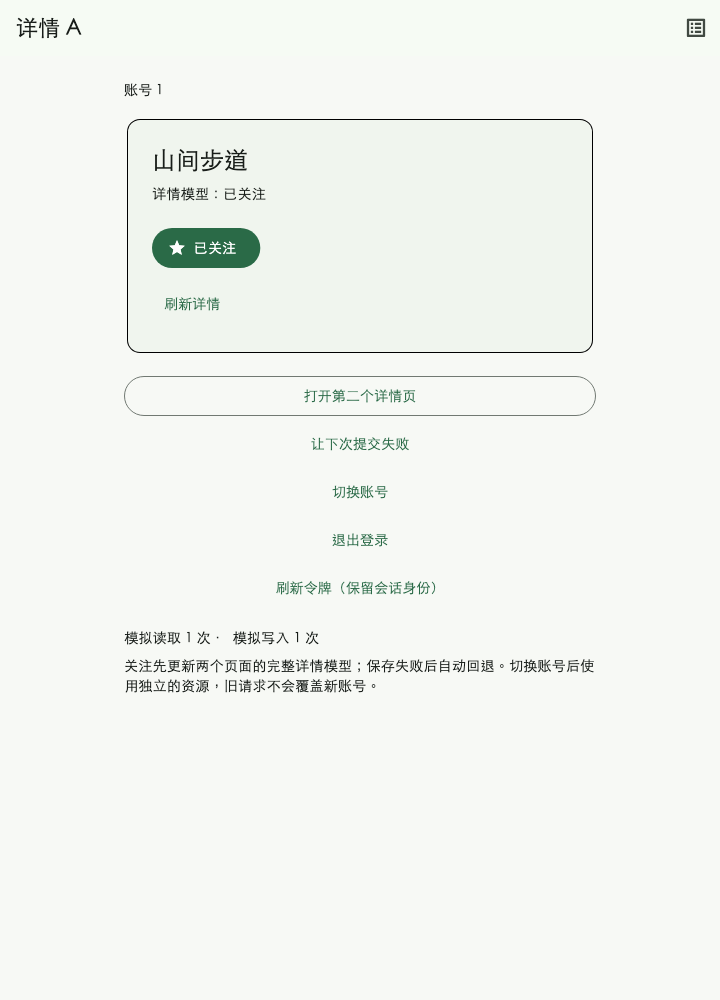

# Oref 3.0 shared follow example

Run `flutter pub get` followed by `flutter run -d chrome` from this directory.
Run the widget integration checks with `flutter test`.
The fake server uses no network or credentials. Its counters display simulated
service calls; physical HTTP behavior is tested separately at the package root.

- Open the second detail page: both pages borrow the same Query and writable
  `followed` field. Opening it adds no detail read.
- Follow an item: its full model changes optimistically on both pages. Pending
  writes share one lock. Simulate a failure to see automatic rollback.
- Switch accounts while a write is pending: the old write still completes for its
  original account, and cannot publish into the new account's resources.
- Refresh the token: the same session namespace remains, while the Query's input
  changes and triggers a fresh detail read.
- Sign out and click follow: choose a simulated account to continue the original
  click, or cancel. Unknown follow state is explicitly read again before writing;
  leaving the page or changing accounts stops the continuation.
- Open the article list from the top-right button: switch categories, append,
  simulate an append failure and retry, open a detail, or pull to refresh. Refresh
  replaces the list with the first page.

`FollowExampleApp` owns the directory and closes it in `dispose`.
`ResourceScope.value` borrows it above the Navigator. The root explicitly chooses
eight idle entries and one minute of retention; these are example settings.

This image was rendered by Flutter's widget test engine at 720 × 1000. Its
capture loaded the macOS STHeiti Light font for Chinese text and the Flutter SDK's
MaterialIcons font.
